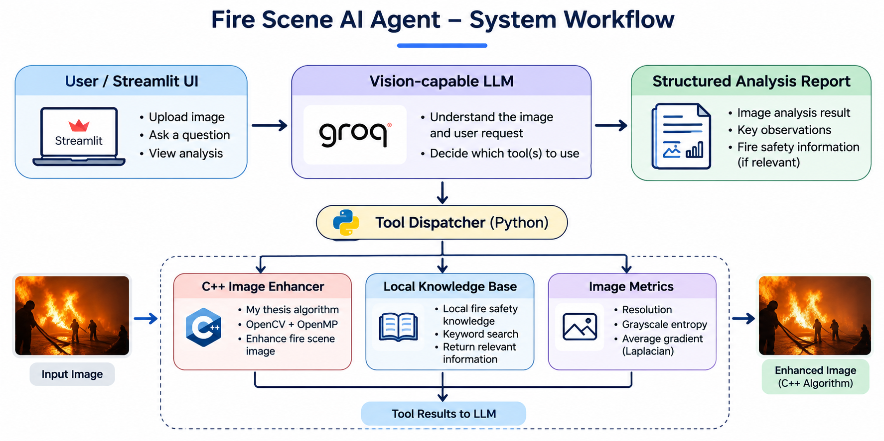

# Fire Scene AI Agent

An experimental AI-agent workflow for fire-scene image analysis. The prototype combines a vision-capable language model, tool calling, a small local fire-safety knowledge base, basic image measurements, and an image-enhancement program developed for my master's thesis.

> **Safety notice:** This is a research/demo prototype, not an emergency-response or fire-safety decision system. Never use its output to decide whether a building is safe, enter a hazardous area, or replace firefighters, emergency services, or trained professionals. AI observations may be wrong, and image enhancement can introduce artifacts.

## Demo workflow

1. Upload a fire-scene image.
2. The AI model reviews the image and user request.
3. The model can choose to call tools:
   - **C++ Thesis Image Enhancement** — runs the original C++ command-line image enhancement program.
   - **Fire Safety Knowledge Search** — retrieves matching entries from a small local knowledge list.
   - **Image Metrics** — calculates image dimensions, grayscale entropy, and average Laplacian magnitude.
4. Tool results are returned to the model for the final structured report.
5. The app displays the original and enhanced image, report, and tool execution details.

## System Architecture



The agent analyzes uploaded fire-scene images and uses available tools when needed. These tools include my C++ thesis image enhancement algorithm, a local fire-safety knowledge base, and image metrics calculation.

## My contribution in this project

This is a personal prototype built to demonstrate an AI workflow and connect my computer-vision research with an AI-agent interface. The C++ enhancement algorithm itself was developed as part of my master's thesis; this project does **not** claim that the thesis algorithm was newly developed here.

My work in this prototype includes:

- Built the Streamlit application for image upload, analysis requests, original/enhanced image comparison, and report display.
- Implemented the agent loop that sends image context to a vision model, receives function/tool calls, dispatches tools, and feeds tool results back to the model.
- Integrated my thesis C++ image-enhancement program through a command-line interface and Python `subprocess`, including temporary input/output image handling and process-error checks.
- Implemented a simple local fire-safety knowledge retrieval tool.
- Implemented basic image measurements (resolution, grayscale entropy, and average Laplacian magnitude).
- Added logging and basic error handling for tool execution.
- Wrote system instructions to encourage uncertainty, state limitations, and avoid unsafe emergency instructions.

## Tech stack

- Python, Streamlit
- Groq API with an OpenAI-compatible SDK client
- Tool/function calling
- OpenCV, NumPy, Pillow
- C++17, OpenCV, OpenMP (thesis enhancement executable)
- `subprocess` integration

## Setup

### 1. Python environment

```bash
python -m venv .venv
```

Windows PowerShell:

```powershell
.\.venv\Scripts\Activate.ps1
pip install -r requirements.txt
```

### 2. Configure environment variables

Copy `.env.example` to `.env`, then add your API key and the full path to the locally built C++ executable.

```env
GROQ_API_KEY=your_api_key_here
OPENAI_MODEL=your_supported_groq_model_name
THESIS_ENHANCER_EXE=C:/path/to/fire_enhancer.exe
```

Do not commit `.env`, API keys, logs, or local binaries.

### 3. Build the C++ enhancer

The included C++ source uses OpenCV and OpenMP. The original development setup used Windows with MSYS2 UCRT64 and a Clang compiler. Build it in an environment with the matching OpenCV/OpenMP dependencies. The executable is intentionally not included because it depends on local runtime DLLs and is not portable.

The executable must support:

```bash
fire_enhancer.exe --image input.jpeg output.jpeg
```

It should return exit code `0` and create the output image.

### 4. Run the app

```bash
python -m streamlit run app/main.py
```

## Tools and evaluation notes

- **Tool selection:** The model decides whether enhancement, knowledge search, or image measurements are useful. Tool selection can vary between prompts and model runs.
- **Image enhancement:** Uses the thesis C++ algorithm. Enhancement output is a visual aid only and may contain artifacts.
- **Knowledge search:** A small keyword-matching local list, not a live or authoritative safety database.
- **Image metrics:** Entropy and average Laplacian magnitude are descriptive image statistics. They do not establish safety or guarantee image quality.
- **Evaluation:** This current prototype has not been formally evaluated for scene-understanding accuracy, safety, reliability, or end-user performance. Manual demonstration and tool execution checks are the current validation. A next step would be a fixed test set, tool-call success rate, report factuality review, and comparison of image metrics before/after enhancement.

## Limitations / next steps

- Prototype; no production deployment or real emergency use.
- Local C++ executable and runtime dependencies must be installed by the user.
- The local knowledge base is small and keyword-based.
- No authentication, role-based access control, persistent database, monitoring dashboard, or formal evaluation pipeline.
- AI image observations can be incorrect or incomplete.
- Add a reproducible evaluation dataset and human review before any real-world use.

## Repository layout

```text
app/main.py                 Streamlit UI, agent loop, tools, and orchestration
cpp/fire_enhancer.cpp       Thesis C++ image enhancement source
cpp/CMakeLists.txt          CMake build configuration
requirements.txt             Python dependencies
.env.example                 Environment-variable template
docs/                       Architecture and demo notes
```
